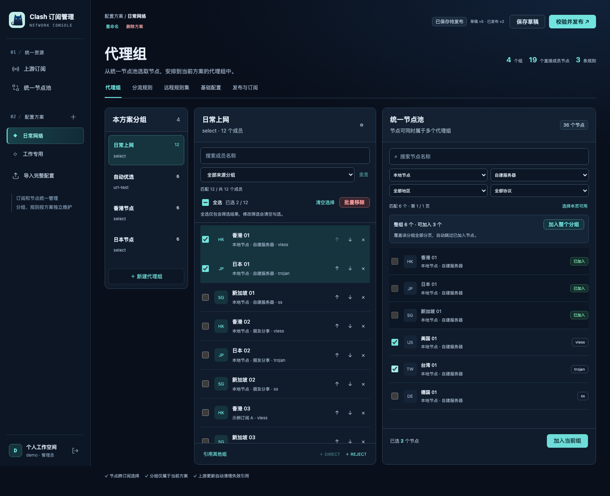
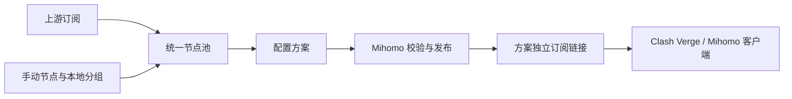

<p align="center">
  
</p>

# Clash Subscription Manager

面向 **Clash Verge / Mihomo** 的自托管订阅与配置管理器。

在浏览器中统一管理多个上游订阅和手动节点，按需编排代理组、分流规则与基础配置，为日常、工作等不同场景生成独立的订阅链接。服务负责配置管理和发布，实际代理连接由客户端完成。

当前版本支持单管理员、多套配置方案，以及 **Docker Compose 配套 MySQL**、**连接已有 MySQL** 两种部署方式。

[功能特性](#功能特性) · [快速开始](#快速开始) · [使用流程](#使用流程) · [开发与验证](#开发与验证) · [文档](#文档) · [开源协议](#开源协议)

## 界面预览

深蓝与冰青配色的三栏工作台：左侧选择代理组，中间管理成员，右侧从统一节点池添加节点。支持桌面布局与窄屏适配。



*截图使用演示数据，不包含真实订阅地址或节点凭据。*

## 功能特性

| 模块 | 功能 |
| --- | --- |
| 上游订阅 | 管理多个订阅地址，手动或定时刷新，查看刷新结果；支持部署者配置的可信出站代理 |
| 统一节点池 | 汇总上游与本地节点，按名称、来源、协议、地区筛选；同一节点可用于多套方案和多个代理组 |
| 手动节点 | 参数表单、分享链接或 YAML 录入，支持批量导入、来源分组、地区选择、跨页多选、批量移动与删除 |
| 代理组 | 三栏可视化编辑，支持 `select`、`url-test`、嵌套代理组、DIRECT / REJECT；可一键加入整个本地分组 |
| 成员批量管理 | 当前代理组支持名称搜索与来源分组组合筛选；全选筛选结果后批量移除，调整成员顺序 |
| 分流规则 | 可视化编辑、标准规则文本批量导入、完整 rules 文本编辑；支持语法高亮、查找替换，保留规则注释与空行 |
| 远程规则集 | 每套方案独立维护规则集，并在规则中选择规则集与目标代理组 |
| 基础设置 | 按方案编辑 DNS、端口、嗅探、IPv6、TUN 等基础 YAML，提供结构和内核校验 |
| 多方案发布 | 每套方案拥有独立草稿、代理组、规则、订阅链接及发布历史；保存与发布分开进行 |
| 完整配置导入 | 将 Clash / Mihomo YAML 导入为新方案草稿，默认将导入节点保留为本地节点，可明确关联上游 |
| 地区配置 | 通过服务器 YAML 维护地区名称、代码、别名与排序，无需修改前后端代码 |

**来源分组**用于整理手动节点，跨方案共享；**代理组**用于客户端路由，每套方案独立维护。一个节点可以属于多个代理组。

导出的节点名称包含来源，便于在客户端区分：

```text
香港 01 · 示例订阅
香港 01 · 自建服务器
香港 01 · 本地节点
```

上游节点使用订阅名称作为后缀；已分组的本地节点使用来源分组名称，未分组节点使用“本地节点”。发生名称冲突时，管理器会追加短标识以保证引用明确。

## 工作方式



### 支持的输入格式

| 输入 | 支持范围 |
| --- | --- |
| Clash / Mihomo YAML | 从上游的 `proxies` 提取节点；整份配置通过“导入完整配置”处理 |
| V2Ray 通用订阅 / URI 列表 | 逐行解析 `ss`、`ssr`、`vmess`、`vless`、`trojan`、`hysteria2` / `hy2`、`tuic` 分享链接 |
| Base64 订阅 | 支持单层 Base64 包装的 YAML 或节点链接列表 |
| 手动粘贴 | 支持单个或多个链接、YAML 节点列表、`proxies:`，以及每行一个 `{ name: ..., type: ... }` 对象 |

YAML 与手动表单另支持 `http`、`socks5` 节点。具体传输方式、参数和限制见[协议支持矩阵](docs/operations/protocol-support.md)。解析在自托管服务内完成，不调用第三方订阅转换服务。

### 刷新、草稿与发布

| 操作或结果 | 生效方式 |
| --- | --- |
| 保存草稿、应用规则文本修改 | 更新草稿或当前工作副本，订阅仍使用已发布版本 |
| 手动发布 | 编译及 Mihomo 校验成功后生成新版本，订阅链接地址保持不变 |
| 上游订阅刷新成功 | 更新节点并清理失效引用；已有发布的方案基于其已发布定义更新，不带入尚未发布的人工编辑 |
| 下载或任一节点解析、校验失败 | 整次更新不提交，保留旧节点、分组关系和订阅配置，并显示具体错误 |
| 返回有效的空节点列表 | 提示选择“保留旧数据”或“清空节点”；未选择时保持原数据 |
| 修改手动节点参数、名称或来源分组 | 相关方案需检查并手动发布，订阅才采用新内容 |

上游节点消失后，管理器会移除它的代理组引用；直接指向该节点的规则改为 `REJECT`，保留匹配条件与顺序。空代理组仍保留，并回退为 `REJECT`。同名节点后来恢复时，不会自动恢复已清理的分组关系。

## 技术栈

| 层级 | 技术 |
| --- | --- |
| 后端 | Java 21、Spring Boot 4、Spring Security |
| 数据库 | MySQL 8.4、MyBatis-Plus、Flyway |
| 前端 | Vue 3、TypeScript、Vite、Element Plus |
| 文本编辑器 | CodeMirror 6 |
| 配置校验 | 固定版本 Mihomo 1.19.33 与离线规则数据 |
| 测试 | JUnit、Testcontainers、Vitest、Playwright / Chromium |
| 部署 | Docker / Docker Compose，前端静态资源由 Java 应用提供 |

具体依赖与镜像版本以[后端 POM](backend/pom.xml)、[前端依赖](frontend/package.json)、[镜像锁文件](deploy/images.lock)及 [Mihomo 锁文件](tools/mihomo/resources.lock)为准。

## 快速开始

需要 **Docker Engine 和 Docker Compose v2**。以下命令均在仓库根目录执行；首次构建需要访问镜像仓库、依赖源和 Mihomo 发行包。

### 准备配置

```sh
cp .env.example .env
./scripts/init-secrets.sh
```

初始化脚本只生成缺少的口令和密钥，不覆盖已有文件。本机 HTTP 体验时，将 `.env` 中对应配置改为：

```dotenv
APP_BIND_ADDRESS=127.0.0.1
APP_PORT=8080
PUBLIC_BASE_URL=http://127.0.0.1:8080
COOKIE_SECURE=false
```

然后选择下面一种数据库部署方式。

### 方式一：启动配套 MySQL

```sh
docker compose -f compose.yaml -f compose.mysql.yaml up -d --build
docker compose -f compose.yaml -f compose.mysql.yaml ps
```

MySQL 使用独立容器和 `mysql_data` 命名卷，数据库端口不映射到宿主机。应用会等待数据库健康后启动，并自动执行数据库迁移。

### 方式二：连接已有 MySQL

为应用准备独立数据库和账号，并授予该账号在此库内执行 Flyway 建表与迁移的权限。MySQL 8.4 为已验证版本。

在 `.env` 中配置连接，例如连接宿主机上的 MySQL：

```dotenv
DB_URL=jdbc:mysql://host.docker.internal:3306/clashsub?sslMode=REQUIRED&serverTimezone=UTC
DB_USERNAME=clashsub
```

将 `secrets/db_password` 的内容替换为数据库真实密码，保存为单行文本。初始化文件为只读；编辑前可执行 `chmod 600 secrets/db_password`，保存后执行 `chmod 444 secrets/db_password`。保持 `secrets` 目录权限为 `0700`。

```sh
docker compose -f compose.yaml up -d --build
docker compose -f compose.yaml ps
```

远程 MySQL 使用容器可达的数据库地址和适合其证书配置的 JDBC TLS 参数。Compose 已配置 `host.docker.internal` 到宿主机；容器中的 `127.0.0.1` 指向容器自身。详细连接说明见[部署文档](docs/operations/deployment.md)。

### 首次登录与服务器部署

服务启动后访问 [http://127.0.0.1:8080](http://127.0.0.1:8080)。默认管理员用户名为 `admin`，初始密码保存在服务器的 `secrets/admin_password` 文件中。

管理员配置仅用于首次初始化；已有数据库中的管理员不会被启动参数覆盖。修改访问端口时，同步调整 `APP_PORT` 和 `PUBLIC_BASE_URL`。

默认服务只绑定宿主机回环地址。部署到服务器时，使用 HTTPS 反向代理指向应用端口，并设置：

```dotenv
PUBLIC_BASE_URL=https://clash.example.com
COOKIE_SECURE=true
```

`PUBLIC_BASE_URL` 决定生成的订阅链接，必须是客户端可访问的地址。反向代理示例、健康检查、架构支持与升级步骤见[部署文档](docs/operations/deployment.md)。

## 常用配置

完整模板见 [.env.example](.env.example)。

| 配置项 | 说明 |
| --- | --- |
| `APP_BIND_ADDRESS` / `APP_PORT` | 宿主机监听地址与端口，默认 `127.0.0.1:8080` |
| `PUBLIC_BASE_URL` | 对外访问的根地址，用于生成订阅链接 |
| `COOKIE_SECURE` | HTTPS 使用 `true`；本机 HTTP 调试设为 `false` |
| `DB_URL` / `DB_USERNAME` | 已有 MySQL 的 JDBC 地址与账号；配套 MySQL 模式会覆盖 `DB_URL` |
| `DB_NAME` | 配套 MySQL 初始化的数据库名，默认 `clashsub` |
| `DB_PASSWORD_FILE` | 数据库密码文件路径，默认 `./secrets/db_password` |
| `ADMIN_USERNAME` / `ADMIN_PASSWORD_FILE` | 首次初始化的管理员名称和口令文件 |
| `APP_ENCRYPTION_KEY_FILE` | 持久加密密钥路径，默认 `./secrets/encryption.key`，必须是原始 32 字节二进制文件 |
| `TRUSTED_OUTBOUND_PROXY_URL` | 可选的可信 HTTP / HTTPS 出站代理地址，界面中以 `default` 别名选择 |
| `UPSTREAM_PRIVATE_ALLOWLIST` | 可选的私网上游 CIDR 白名单，默认空；只配置实际需要的地址范围 |
| `NODE_REGIONS_FILE` | 地区配置文件，默认 `./config/node-regions.yaml`，Compose 以只读方式挂载 |

### 可信代理与 Fake-IP

已配置可信出站代理时，新增订阅默认使用 `default`，仍可手动选择直连；已有订阅保持原来的连接方式，需要在编辑页明确切换。

遇到 `UPSTREAM_ADDRESS_BLOCKED` 时，可检查订阅域名是否被 Clash / Mihomo 的 Fake-IP 解析为保留地址。为该来源选择部署者配置的可信代理，或让该域名返回真实 IP。Docker 中的代理地址必须能被应用容器访问。详见[上游抓取与代理配置](docs/operations/upstream-fetch.md)。

### 自定义地区

编辑 [config/node-regions.yaml](config/node-regions.yaml)，即可扩展地区名称、两位代码、识别别名与显示顺序。地区自动识别依据节点名称，也支持手动指定。

修改后重建应用容器即可生效，无需重新构建镜像。已有节点会按新地区表重新归类；具体格式与命令见[地区配置说明](docs/operations/node-regions.md)。

## 使用流程

1. **准备节点：** 在“上游订阅”添加订阅并刷新，或在“手动节点”中录入、批量导入节点并整理来源分组。
2. **创建方案：** 新建“日常网络”“工作专用”等配置方案，每套方案独立维护代理组与规则。
3. **编排代理组：** 从统一节点池跨来源选择节点，或一键加入整个本地分组；在当前组中按名称、来源分组筛选后全选并批量移除。
4. **配置分流：** 可视化维护规则，或编辑完整 rules 文本；按需添加远程规则集及 DNS、端口等基础 YAML。
5. **校验并发布：** 保存草稿供后续编辑，确认配置后执行校验与发布。校验失败时按诊断修正后再提交。
6. **接入客户端：** 在“发布与订阅”中显示、复制订阅链接，添加到 Clash Verge 等 Mihomo 客户端的远程配置中。

当前代理组的“全选”仅包含筛选结果，修改筛选条件会清空勾选。批量移除只调整当前代理组的成员引用；手动节点列表的“批量删除”才是删除节点本身。

## 数据与备份

管理接口使用管理员会话与 CSRF 防护；订阅地址、节点参数、草稿和发布内容等敏感数据加密保存。每套方案的订阅链接使用独立 Token，支持重置。

- `.env`、`secrets/`、数据库备份和真实节点配置应保存在仓库之外的受控位置，或使用仓库已有的忽略规则排除。
- **数据库备份与 `secrets/encryption.key` 必须配套保留。** 更换或丢失密钥会导致已有加密数据无法读取。
- 订阅链接可下载包含节点凭据的配置，应按凭据保管；反向代理日志应关闭或脱敏 `/sub/` 路径。
- 配套 MySQL 的数据保存在命名卷中；正常升级应保留此卷。

备份、恢复到新空库及升级前准备见[备份与恢复文档](docs/operations/backup-restore.md)。仓库提供 `scripts/backup.sh` 和 `scripts/restore.sh`。

## 开发与验证

开发环境使用 **Java 21、Node.js 24、pnpm 11.25.0**。集成测试和部署验收需要 Docker。

### 前端开发

在本机已启动 8080 后端的基础上运行：

```sh
pnpm --dir frontend install --frozen-lockfile
pnpm --dir frontend dev
```

Vite 默认代理 API 和订阅下载到 `http://127.0.0.1:8080`。本机 HTTP 开发需将后端的 `COOKIE_SECURE` 设为 `false`；生产静态资源由 Java 应用直接提供。

### 验证命令

首次运行浏览器测试前安装 Chromium：

```sh
pnpm --dir frontend install --frozen-lockfile
pnpm --dir frontend exec playwright install chromium
```

```sh
# 前端、后端、MySQL 集成与实际 Mihomo 校验
./scripts/verify.sh

# 配套 MySQL 部署、发布与备份恢复验收
./scripts/acceptance.sh bundled

# 使用独立测试数据库模拟“已有 MySQL”模式
./scripts/acceptance.sh external
```

验收脚本创建并清理独立测试项目，使用合成节点与测试数据库。更多前端结构、Maven 配置与验证范围见[前端开发文档](docs/development/frontend.md)、[部署文档](docs/operations/deployment.md)及[验收记录](docs/operations/verification.md)。

## 项目结构

```text
.
├── backend/             # Spring Boot API、配置编译、刷新与发布
├── frontend/            # Vue 管理界面与浏览器测试
├── config/              # 可配置的节点地区表
├── deploy/              # 容器入口、健康检查与镜像锁文件
├── docs/                # 部署、使用、API 与设计文档
├── scripts/             # 初始化、构建验证、备份恢复与验收脚本
├── tests/               # 合成订阅与测试夹具
├── tools/mihomo/        # 固定内核下载脚本与离线校验资源
├── compose.yaml         # 应用服务，可连接已有 MySQL
├── compose.mysql.yaml   # 配套 MySQL 的叠加配置
├── Dockerfile           # 前后端与校验内核的多阶段构建
└── .env.example         # 部署配置模板
```

## 当前范围

当前版本面向个人自托管，采用单管理员、单应用实例；数据按 owner 隔离，为后续多用户扩展预留边界。暂未提供多用户注册、节点测速和历史版本一键回滚。

配置兼容范围以固定 Mihomo 内核和已实现的字段校验为准。不支持的高级内容会在完整导入时保留原文并列出问题，处理后才可发布。规则文本保留注释与空行，但不承诺整份原配置逐字还原。

校验通过表示配置可以被固定内核接受，不代表节点可连接；远程规则集由客户端实际下载。详细边界见[配置校验说明](docs/operations/validation.md)。

## 文档

| 主题 | 链接 |
| --- | --- |
| 部署与升级 | [部署、健康检查及运行配置](docs/operations/deployment.md) |
| 备份与恢复 | [数据库与密钥备份](docs/operations/backup-restore.md) |
| 订阅抓取 | [出站代理、Fake-IP 与地址检查](docs/operations/upstream-fetch.md) |
| 刷新语义 | [节点变化、空订阅与引用清理](docs/operations/refresh.md) |
| 手动节点 | [录入、来源分组、批量操作与生效时间](docs/operations/manual-nodes.md) |
| 地区字典 | [添加或修改节点地区](docs/operations/node-regions.md) |
| 规则与设置 | [完整规则文本、注释、规则集和基础 YAML](docs/operations/rules-and-settings.md) |
| 导入配置 | [完整导入、关联上游与保留本地节点](docs/operations/import-and-binding.md) |
| 发布订阅 | [发布版本与订阅链接](docs/operations/publishing.md) |
| 格式兼容 | [输入协议矩阵](docs/operations/protocol-support.md) |
| 开发接口 | [API 契约](docs/api/contracts.md) |

## 开源协议

Copyright (C) 2026 xueleilei and contributors.

本项目原创代码采用 **GNU General Public License v3.0 only**（SPDX：`GPL-3.0-only`）发布，完整条款见 [LICENSE](LICENSE)。你可以按照 GPL 第 3 版的条款使用、修改和再分发本项目。

本项目不提供任何担保，包括适销性或特定用途适用性的默示担保。具体权利、义务及担保限制以许可证全文为准。

第三方依赖、Mihomo 内核及规则数据保留各自的许可证和版权声明。随仓库分发的规则数据及 GeoLite2 数据另见[资源来源与许可说明](tools/mihomo/resources/NOTICE.md)和[上游许可证](tools/mihomo/resources/UPSTREAM_LICENSE)。
