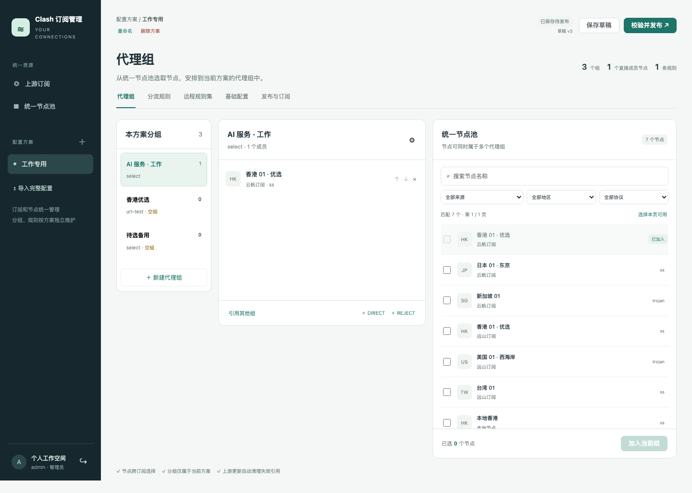

# 首版验收记录

验证日期：2026-11-03。数据均为合成订阅、随机测试口令和隔离数据库；未连接用户实际 MySQL，也未部署用户服务器。

| 检查 | 结果 |
| --- | --- |
| 前端真实 Chromium 组件测试 | 48 / 48 通过 |
| 后端单元测试 | 72 / 72 通过 |
| MySQL / Mihomo 集成测试 | 85 / 85 通过，零跳过 |
| TypeScript 检查、Vite / Maven 构建 | 通过 |
| 配套 MySQL 容器模式 | 2 / 2 端到端流程、重启、完整备份恢复通过 |
| 已有 MySQL 模式（独立测试实例） | 2 / 2 端到端流程、重启、完整备份恢复通过 |
| Linux arm64 应用镜像 | 构建及两种部署完整验收通过 |
| Linux amd64 应用镜像 | 构建、JRE 与 Mihomo 启动检查通过；未重复整套数据库验收 |
| 容器实际配置 | UID 10001、根目录只读、移除全部 capabilities、无设备或 Docker socket、HTTP 仅绑定 loopback |
| 桌面 / 390px 窄屏 | 三栏 / 顺序堆叠布局、无横向溢出、无浏览器运行错误 |

端到端流程覆盖双来源同名节点、独立方案、跨源组、规则与远程规则集、YAML、发布下载、上游参数变化、失效引用清理、草稿隔离、部分解析失败、空结果保留/清空与旧确认失效、完整文件导入、本地绑定、重新发布、Token 轮换、应用重启，以及真实服务端会话失效后的原页面和未应用表单恢复。

恢复演练在停止应用后备份数据库并单独备份密钥，再删除**本次隔离测试栈**、重建空数据库、恢复并重新启动。订阅 Token、发布内容、草稿、节点参数和刷新配置摘要一致；错误/缺失密钥拒绝启动，非空库拒绝恢复，应用日志未包含测试密码或 Token。

验证平台为 macOS arm64 上的 Docker Desktop（Engine 27.5.1、Compose 2.32.4）；容器运行 MySQL 8.4.13、Temurin JRE 21.0.13+9、Mihomo 1.19.33。应用 0.1.0-SNAPSHOT 使用 Spring Boot 4.1.2、Vue 3.5.44；完整固定版本和摘要见 POM、前端 lockfile、`deploy/images.lock` 和 `tools/mihomo/resources.lock`。

完整实现另经一次独立全量代码审查。发现的四项前端问题已以失败回归测试复现并修复：旧读取回退保存结果、跨方案删除确认错配、连续来源删除确认错配、会话过期丢失未应用表单。相关测试还验证重新认证时暂停后台轮询、同账号恢复原路由和输入、换账号清除旧编辑。最终完整验证为 48 个前端、72 个后端单元和 85 个集成测试，均通过且无跳过。

[审查处理与执行裁定](review.md) 记录修复、边界与暂缓的文档小问题。

正式界面截图使用本地合成节点；与容器中的同一前端代码一致：



[窄屏截图](../screenshots/workspace-mobile.png)

复现命令：

```sh
./scripts/verify.sh
./scripts/acceptance.sh bundled
./scripts/acceptance.sh external
```

完整验收结果不代表真实上游节点可达；Mihomo 仅执行离线配置校验。amd64 当前验证到构建与二进制启动，部署到该架构后仍应执行自身环境验收。

## 刷新兼容性修复回归（2026-11-03）

修复可信代理抓取遇到本地 Fake-IP 被误拦截，以及 ECH、smux、Hysteria2 数字参数和部分转换器默认字段被误拒绝的问题。新增测试先在旧实现上复现失败，再确认修复后通过。

本次 `scripts/mvn.sh verify` 通过 78 项后端单元测试、86 项 MySQL / Mihomo 集成测试，零失败、零跳过。覆盖域名经可信代理抓取、直接连接及 IP 字面量仍受限、混合 DNS 结果和元数据重定向被拒绝、兼容字段完整保留，以及非法字段阻止整批提交。输出由固定 Mihomo 1.19.33 实际校验。本次未重复前端和容器部署验收，上方相应记录为首版基线。

在用户明确授权的两个实际订阅上另完成刷新验证，均成功通过抓取、完整解析、内核校验和数据库提交；未测试代理节点的网络连通性。真实订阅地址、内容和凭据不进入夹具或源码包。
