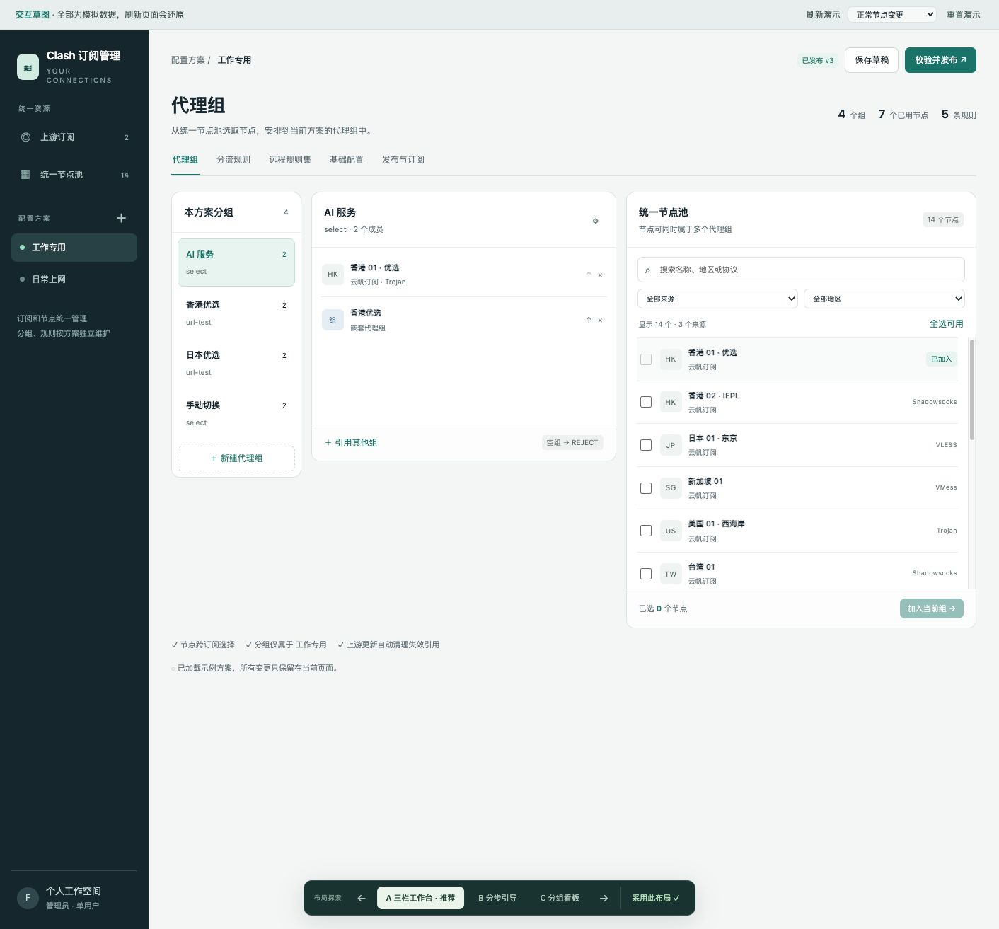

# Clash 订阅节点管理器：第一版设计

日期：2026-11-03（Asia/Shanghai）

状态：用户已于 2026-11-03 确认全文设计；独立审阅提出的产品问题已解决。进入实施计划阶段，尚未开始正式应用实现。

## 1. 目的与成功标准

将多个上游订阅中的节点统一管理，按自己的需要组成多个独立配置方案。每个方案维护代理组、分流规则、远程规则集和基础设置，生成可供 Clash Verge 拉取的固定订阅链接。

成功的使用过程：

1. 添加多个订阅，获取统一节点池；或先导入已有完整 YAML。
2. 在某个配置方案里，跨订阅手动选择节点并安排代理组、规则。
3. 保存草稿，校验并发布；在 Clash Verge 中导入该方案的订阅链接。
4. 上游刷新成功后，同名节点参数更新，消失的节点及其引用自动清理，已发布配置同步更新。
5. 网络或解析失败不会误删节点；合法空列表先让用户选择保留还是清空。

目标客户端按 Clash Verge Rev / Mihomo 配置能力实现，交付时标明测试过的内核版本。旧客户端的未知兼容性不宣称已覆盖。

## 2. 已由用户确定的产品决策

| 主题 | 已确认行为 |
| --- | --- |
| 产品形态 | 独立 Web 管理器，输出订阅链接；部署在用户自己的服务器上 |
| 用户范围 | 第一版一个管理员；数据模型预留用户归属，后续扩展各用户独立的数据 |
| 多配置 | 第一版支持多套配置方案；上游订阅和节点统一管理，分组、规则、规则集、基础配置、链接按方案独立 |
| 节点身份 | 同一订阅来源＋上游原始节点名称；参数改变保留分组，改名视为旧节点消失和新节点出现 |
| 刷新失败 | 网络、认证、解析或部分节点解析失败：整体保留上次成功数据及组引用，显示具体错误 |
| 合法空列表 | 提供“保留旧数据”和“清空节点”两个选择；未选择前保留，用户可以选择不清空 |
| 空代理组 | 保留代理组和规则引用，默认拒绝连接 REJECT，并提示补充成员 |
| 规则直接引用失效节点 | 保留匹配条件和顺序，将目标改为 REJECT，记录变更并提示重新选择节点或代理组 |
| 代理组类型 | 第一版支持 select、url-test、组间引用，禁止循环引用 |
| 规则编辑 | 可视化规则列表＋标准规则文本批量导入，允许调整顺序 |
| 远程规则集 | 第一版支持，每个方案独立维护，通过 RULE-SET 选择规则集和目标代理组 |
| 基础设置 | DNS、端口、嗅探等按方案独立维护；第一版使用带校验的 YAML 编辑 |
| 上游格式 | Clash/Mihomo YAML、明文节点链接列表、Base64 编码的节点列表 |
| 刷新触发 | 单个手动刷新、全部手动刷新、按订阅独立设置定时刷新；默认 6 小时 |
| 发布流程 | 编辑草稿→校验并发布；后台同步节点可以更新已发布配置，但不能夹带未发布的人工编辑 |
| 后端 | 用户熟悉 Spring Boot / Java，确定使用这一技术路线 |
| 数据库 | MySQL，同时支持连接现有实例和 Docker Compose 启动数据库容器 |
| 完整配置导入 | 第一版支持完整 YAML 导入为配置草稿 |
| 无法关联的导入节点 | 保留为本地节点，可分组和发布，后续手动关联；关联前不参与上游更新和删除 |
| 输出节点范围 | 只输出该方案实际使用的节点，包含嵌套组间接引用的节点 |
| 访问控制 | 管理员账号密码登录；每个方案独立随机订阅 Token，长期有效、可重置，旧 Token 重置后失效 |
| 主交互布局 | A 三栏工作台：左侧代理组、中间当前成员、右侧统一节点池 |

客户端在自己的下一次订阅刷新时获取更新。管理器不直接控制本机 Clash Verge，也不承诺将变更实时推送到所有客户端。

## 3. 考虑过的方案与选择

### 3.1 Web 服务与本机配置工具

- **Web 服务＋固定订阅链接，已选择。** 在服务器持续刷新上游，多个设备可使用同一方案，配置和客户端解耦。
- 本机工具直接修改 Clash Verge 文件：更依赖设备路径、客户端版本和本机运行状态，不符合已选择的服务器部署方式。

### 3.2 后端与数据库

- 最初推荐 Vue＋TypeScript/Fastify＋SQLite，优点是统一语言、单容器部署。
- 讨论过 Vue＋Go＋SQLite，优点是后端可编译成独立程序，但前后端使用不同语言。
- **最终选择 Vue＋Spring Boot/Java＋MySQL。** 用户熟悉 Spring Boot，已有服务器和 MySQL，后续自行维护更方便。
- SQLite 在当前低写入频率和个人使用规模下预计足够；选择 MySQL 的依据是用户现有环境和维护习惯，不把“小规模多用户”误写成 SQLite 必须迁移的条件。

### 3.3 界面

- **A 三栏工作台，已选择。** 分组、成员和候选节点同时可见，适合频繁地在不同来源之间调整。
- B 分步引导：分步选择节点和目标组，过程明确，但反复调整时需要来回切换。
- C 分组看板：方便并排查看组，添加节点依赖侧栏；更多分组时需要滚动。

本次一次性草图只用于确认交互，全部为模拟数据。正式版使用 Vue 重写，不把原型的简单解析和模拟校验作为生产实现。

## 4. 第一版功能与交互

### 4.1 上游订阅与节点池

订阅支持添加、编辑名称和地址、配置输入格式、刷新周期、启停定时任务和手动刷新。自动识别格式，也允许明确指定格式。节点列表支持按名称、订阅来源、协议和地区信息筛选；不能确定地区时标为未知，不凭服务器地理位置猜测节点质量。

展示每个订阅的节点数量、最近一次成功时间、最近一次尝试状态及脱敏错误。刷新全部按来源独立处理：一个来源失败不回滚其他来源已经成功的刷新。

一个节点可加入多个组，也可被多个配置方案引用。新节点不会自动加入手工组；失而复现的节点也不会自动恢复此前已清理的组关系。

### 4.2 A 三栏代理组工作台

- 左栏：当前方案的组、类型、成员数量、空组标记；选择、新建及编辑代理组。
- 中栏：当前组成员及顺序、来源、嵌套组；移除、排序、引用其他组。
- 右栏：统一节点池，搜索、筛选、多选、批量加入；当前组已经直接包含的节点不可重复加入。
- 支持 select 和 url-test；后者可配置测试地址、间隔、容差及导入时需要保留的兼容参数。
- 成员支持节点、同方案代理组，以及 DIRECT/REJECT 内置策略；内置策略用于完整导入现有配置和常见分流设置。
- 代理组使用内部 ID 关联。重命名同步维护结构化引用；不能跨方案引用组。
- 删除仍被其他组或规则引用的组时，列出引用并要求先解除或明确替换，不能留下悬空引用。

空组是合法的管理状态。导出时给予明确的 REJECT 回退，不能因客户端的默认空组行为意外直连。空组不算发布错误，但发布预览必须列出这些组。

### 4.3 规则与规则集

规则具有明确的顺序、类型、匹配内容、目标策略和适用的附加参数。常用类型至少包括现有样例使用的 DOMAIN、DOMAIN-SUFFIX、DOMAIN-KEYWORD、IP-CIDR/IP-CIDR6、PROCESS-NAME、GEOSITE、GEOIP、MATCH，以及新增管理需要的 RULE-SET。

编辑器默认目标为当前方案的代理组、DIRECT 或 REJECT。完整导入遇到节点直接作为规则目标时，保留该节点引用并计入输出依赖，不能静默改为其他策略。

如果规则直接引用的上游节点在成功刷新中消失，保留规则的匹配条件、附加参数和位置，将目标改为 REJECT，并在变更记录中列出，提示用户改选其他节点或代理组。不能直接删除该规则，避免流量落到后面的其他规则或兜底策略。经明确确认清空订阅时采用同样的处理。此处理已由用户于 2026-11-03 确认。

提供逐条编辑、批量粘贴/文件导入、导出、上移/下移及指定位置移动。大量规则采用分页或虚拟列表，排序操作针对绝对规则顺序，不能因筛选改变未显示规则的相对顺序。

规则导入先预览和报告行号、语法及引用错误；存在错误时不部分覆盖现有草稿。默认将普通规则插入 MATCH 前，导入 MATCH 时明确替换现有兜底。最终只允许一个位于末尾的 MATCH。

高级标准规则采用保留原始表达式的编辑方式。解析不能简单按所有逗号拆分，必须识别括号、引号和附加参数。不能理解或验证的引用列为待处理问题，不能静默丢弃规则。基础配置中其他字段引用组名时，同样需要检查；无法安全改写的高级文本在组改名时阻止发布并定位问题。

每个方案独立保存 HTTP rule-providers：名称、URL、behavior、format、interval，及必要的下载参数。支持 domain/ipcidr/classical 行为及其有效格式组合。用户在规则列表中选择规则集与目标策略。规则集内容的下载和定期更新由客户端内核执行；管理器主要维护其定义和引用。

### 4.4 基础 YAML

每个方案保存一份基础 YAML 原文，覆盖 DNS、端口、嗅探、IPv6 等不属于节点及分流编辑器的配置。

发布时解析基础 YAML，再合入生成的 proxies、proxy-groups、rule-providers 和 rules。禁止通过基础 YAML 覆盖这些管理器拥有的字段。其他兼容字段按原意保留，不承诺保留 YAML 的原始注释、缩进和锚点写法。

第一版不递归联网展开 proxy-providers。仅包含外部代理提供者而不含内嵌节点的上游，报明确的不支持错误；完整导入遇到 proxy-providers/use 依赖时列为待迁移问题，不能忽略依赖后直接发布。

草稿允许暂存未完成内容；编辑器展示错误位置，只有校验通过才能发布。

### 4.5 草稿、发布与订阅

手动修改先进入当前方案草稿。页面明确显示“未保存”“已保存待发布”“与已发布版本一致”。点击发布可以先提交当前编辑内容，在同一次受版本保护的操作中校验和创建发布版本。

发布预览展示将输出的唯一节点数、代理组、规则、空组及变更摘要。失败保持上一个有效发布版本和 Token 不变。每个成功发布产生不可变的定义快照、源数据版本清单和实际输出 YAML。

订阅下载直接读取已保存的有效发布产物，不能在客户端请求中临时抓取上游或重新编译。没有成功发布的方案不能返回看似可用的空配置。客户端请求使用独立 Token，不依赖管理员浏览器登录会话。

节点导出包括所有本方案代理组的成员、嵌套组依赖、规则直接引用节点和必要的节点链式依赖。未使用的节点不输出。导出的节点名在最终配置中必须稳定且唯一，避免跨订阅同名、与组名或内置策略重名；内部身份不依赖导出展示名。

提供最近刷新与发布的可读记录，便于解释自动清理。第一版不把“一键回滚历史节点凭据”作为必需功能；历史快照不能自动把已经失效的节点重新加入当前组。

### 4.6 完整配置导入

导入过程为：读取文件→解析并预览→关联来源→生成新草稿→检查发布。

导入基础设置、全部节点定义、组及组引用、规则顺序和规则集。使用新的内部 ID 重建关联，不能仅靠显示名称维持跨来源身份。

尝试按完整的连接配置匹配已有上游节点；仅唯一匹配时给出关联建议，由用户确认。名称相同但连接参数不同不能自动关联；多个来源参数相同也属于需要用户选择的歧义。

未匹配或用户选择保留的节点建立本地导入记录，保持连接参数，可正常加入组及发布，不参加远程刷新。

后续“关联上游”是人工编辑：预览受影响的方案，将相关草稿中的引用改为所选上游节点；既有发布版本仍保持原本地节点，直到对应方案再次发布。不要因关联操作直接改变未批准发布的配置。

导入出现缺失引用、暂不支持的组类型或无法理解的高级字段时，在预览中列出。允许保留待处理的草稿，但不能假装完整兼容或默默移除内容。

## 5. 刷新、一致性与异常语义

### 5.1 节点身份

- 远程节点：来源的稳定内部 ID＋原始节点名称的精确值；改订阅显示名或地址不会自动改变来源 ID。
- 同来源同名且参数变化：更新节点参数，保留成员关系。
- 同来源名称消失：从当前草稿和当前发布定义的组成员中移除；直接指向该节点的规则保留原位置并改为 REJECT。新名称等待手工分组或重新指定规则目标。
- 不同来源同名：不同节点，不按地址、名称或协议自动跨来源去重。
- 同一输入中出现重复原始名称：整体拒绝刷新，避免任意合并。
- 本地节点：独立内部 ID，不接受其他订阅的同名节点自动认领。

没有名称的 URI 使用确定性的合成名称作为替代标识，至少由协议、服务器和端口构成；同来源冲突时要求补充名称或修正输入。服务器或端口改变可能改变这种合成名称。此条是实现默认，见第 10 节。

### 5.2 单个来源刷新

1. 建立刷新任务，记录来源配置版本；同一来源同时只运行一个任务，重复触发复用已有任务状态。
2. 在数据库写事务之外完成下载、格式检测、解码、解析及节点参数检查。
3. 任意节点/必要参数无法解析、重复名称、HTTP/认证/格式错误，都不提交节点快照。
4. 合法空结果建立待确认记录，旧快照仍是有效快照。
5. 非空候选结果与有效快照比较，计算新增、参数更新、移除。
6. 基于各方案的当前已发布定义生成候选发布产物；单独生成草稿中的组成员清理及失效节点规则目标改为 REJECT 的补丁。
7. 校验全部受影响的候选发布产物。任何一个无法生成有效配置，则本次来源更新不落为有效快照，显示失败原因。
8. 用短事务检查来源版本及相关方案版本未变化，原子提交节点、引用清理、当前发布指针和刷新结果。并发冲突时基于最新版本重新计算，不能覆盖新的人工修改。

“完整解析成功”是必要条件；生成的已发布配置也必须通过一致性与内核校验，才能把新快照对外生效。草稿中尚未修好的人工编辑不参与这次自动发布校验。

~~~mermaid
sequenceDiagram
    participant Trigger as 定时器/手动刷新
    participant Sync as 订阅同步服务
    participant Upstream as 上游订阅
    participant Compiler as 配置编译与校验
    participant DB as MySQL
    Trigger->>Sync: 刷新来源（记录配置版本）
    Sync->>Upstream: 请求订阅（事务外）
    Upstream-->>Sync: 内容或错误
    Sync->>Sync: 完整解析、判空、计算差异
    alt 失败或等待空列表确认
        Sync->>DB: 只记录状态，保留有效数据
    else 非空有效候选/确认清空
        Sync->>DB: 读取当前发布定义及草稿版本
        Sync->>Compiler: 生成并验证候选发布产物
        Compiler-->>Sync: 产物或错误
        Sync->>DB: 校验版本并原子提交
    end
~~~

### 5.3 合法空结果的人工决定

待确认记录保存来源 ID、候选结果、对应来源配置版本及有效快照版本。

- 保留旧数据：将此次空结果标为已处理，节点和引用不变。
- 清空节点：按一次明确确认的空快照执行引用清理和发布编译；空组以 REJECT 保留，直接引用被清空节点的规则目标改为 REJECT。
- 未选择、关闭提示、管理员离线：不清空。管理页面显示待处理事项。
- 重复的相同空结果合并为一个待处理事项，不反复弹窗。
- 后续刷新产生新的有效结果或用户修改来源配置时，旧确认失效；旧弹窗不能清空后来恢复的节点。

空字符串、登录页和不能判定格式的内容属于解析失败，不能自动当成合法空列表。

~~~mermaid
stateDiagram-v2
    [*] --> Ready: 已有有效快照或新来源
    Ready --> Fetching: 手动/定时触发
    Fetching --> Ready: 非空候选校验并提交成功
    Fetching --> Failed: 请求/解析/编译失败
    Failed --> Fetching: 再次刷新
    Fetching --> PendingEmpty: 合法空结果
    PendingEmpty --> Ready: 保留旧数据
    PendingEmpty --> Ready: 确认清空并提交
    PendingEmpty --> Fetching: 再次刷新
~~~

状态展示与有效数据分离：Failed 或 PendingEmpty 状态下仍可使用上一份有效快照。

### 5.4 草稿与发布版本分离

草稿和发布定义使用不同存储记录，发布定义不可变；“当前发布版本”由指针选择。

自动刷新从旧发布定义产生一个新的自动发布版本，只更新节点参数、删除失效组成员、将直接引用失效节点的规则目标改为 REJECT，以及处理空组。它绝不从当前人工草稿直接生成已发布内容。

自动引用清理及上述规则目标回退也作用于草稿，以免后来发布时复活失效引用。分别基于草稿和发布定义当前实际引用的节点处理；草稿中已改为其他有效目标的规则不受影响。草稿其他未发布内容、基础 YAML、规则修改及编辑状态保留。

数据库提交失败或并发版本不匹配时，旧版本继续服务。网络请求、文件解析和内核校验均不持有长时间数据库写事务。

### 5.5 定时与启停

默认按来源每 6 小时刷新，周期持久化；服务重启后过期任务最多补一次，避免堆积重放。同来源任务串行，不同来源采用有界并发。

暂停自动刷新只停止定时任务，保留节点及输出。手动删除来源属于全局变更，需要显示受影响方案并明确选择清理节点或转为本地保留；不得在没有说明影响的情况下静默破坏多个方案。

## 6. 技术方案与模块边界

推荐组合：

| 部分 | 方案 |
| --- | --- |
| 前端 | Vue 3、TypeScript、Vite、Element Plus，Composition API / script setup |
| 后端 | Java 21、受支持的 Spring Boot 4.x 稳定版本、Maven |
| Web 与身份认证 | Spring MVC、Spring Security，管理员浏览器会话 |
| 持久化 | MyBatis-Plus、MySQL；版本化数据库迁移 |
| 调度 | Spring 调度触发＋有界后台执行器＋数据库任务状态和版本保护 |
| 配置处理 | 安全的 YAML 解析/序列化、协议输入适配器、内部标准节点模型、确定性编译器 |
| 内核验证 | 固定版本的 Mihomo 配置检查子进程，独立工作目录和资源限制 |
| 交付 | Docker 多阶段构建、Docker Compose；前端构建产物由应用提供 |

具体补丁版本、数据库迁移库、HTTP 客户端和编辑器组件由实施计划锁定并验证兼容性。生产依赖不使用浮动 SNAPSHOT 或 latest。

后端采用按业务职责组织的模块化单体，不在第一版拆微服务：身份与归属、订阅来源、节点池、配置草稿、配置编译发布、导入、任务与变更记录。

协议解析模块只负责转换和检查输入；不能直接修改数据库成员关系。配置编译模块应可在给定来源快照和方案定义时确定性地产生 YAML，便于独立测试。

### 6.1 输入协议兼容范围

Clash/Mihomo YAML 导入保留支持内核的完整连接参数，不能只抽取 server/port/password 等少数字段。现有样例至少必须完整覆盖 vless、ss、hysteria2、tuic 及其实际使用的参数。

URI/Base64 适配器的推荐第一版目标：ss、ssr、vmess、vless、trojan、hysteria2/hy2、tuic。Base64 是包装形式，不等于一种节点协议。

每个适配器明确支持的 URI 变体、传输方式及 TLS/Reality 等参数；未知影响连接行为的参数不能被静默丢弃。不能转换到目标 Mihomo 版本的输入报告具体协议/字段错误，并拒绝该次来源刷新。

具体参数矩阵由实现者依据协议官方规范和测试夹具确定并随交付文档列出；未验证的能力不能仅凭“通用订阅”字样宣称支持。所有转换在自托管服务内完成，不把订阅地址和节点凭据发给第三方转换网站。

### 6.2 校验与 Mihomo 边界

校验分三层：

1. 输入语法、类型、容量和协议字段校验。
2. 业务语义校验：名称冲突、归属、悬空引用、循环引用、规则顺序、托管字段冲突。
3. 对生成配置执行固定版本 Mihomo 的配置检查。

Mihomo 提供“检查配置并退出”的运行模式。实现时用独立临时目录、固定可执行文件、参数数组和超时执行，不能把用户 YAML 变成 shell 命令，也不能启动长期运行的代理/TUN 服务。需要在工程验证中实测该版本检查器的初始化行为。[源码依据](https://raw.githubusercontent.com/MetaCubeX/mihomo/Meta/main.go)

检查器使用受控的地理数据及规则集测试资源，不能依赖任意用户本机文件。远程规则集定义检查与其网络可用性分开：使用无网络副作用的校验副本验证结构及引用，明确不宣称已下载并验证远程规则内容。对副本所作替换不得进入最终导出配置。若固定内核版本不能可靠隔离这类副作用，实施时必须先解决检查器封装，不能直接绕过该层并声称内核校验成功。

发布检查不包含代理节点连通性、速度、流媒体解锁和用户设备上的网络可达性测试。

## 7. 数据模型与存储

采用“来源/节点关系数据＋方案文档快照”的组合：

| 对象 | 关键职责 |
| --- | --- |
| User | 用户 ID、管理员身份、密码散列；第一版只有一个可登录管理员 |
| SubscriptionSource | 用户归属、稳定来源 ID、名称、加密 URL、输入设置、周期、配置版本、当前有效快照 |
| SourceSnapshot | 来源候选/有效版本、解析节点、摘要及上游响应元信息；敏感内容加密 |
| Node | 用户/来源归属、稳定 ID、原始名称、协议与展示字段、加密连接配置、本地或远程来源 |
| ConfigurationProfile | 用户归属、名称、当前草稿及发布版本指针、订阅 Token 信息 |
| ProfileDraft | 版本号、基础 YAML 原文、顺序化的组/规则/规则集文档及编辑状态 |
| ProfileRelease | 不可变定义快照、所用来源版本、生成 YAML、摘要、版本号、手动或自动发布原因 |
| RefreshAttempt | 来源、任务状态、开始/结束时间、差异统计、脱敏错误 |
| PendingEmptyDecision | 空结果对应的来源及快照版本、待处理/保留/清空/已过期状态 |

组、成员、规则、规则集作为有稳定内部 ID 的有序类型化文档存入草稿与发布快照；Java 使用明确 DTO，不以无约束 Map 作为业务契约。节点池仍以独立记录索引，能够根据内部引用查出受影响的方案。当前个人规模可以扫描同用户的方案引用；实际查询和索引在实施时按数据量验证。

所有人工编辑携带期望版本号，冲突返回可理解的提示，保留用户尚未提交的编辑内容。自动刷新同时检查来源和受影响方案的版本。多个来源影响同一方案时，失败的竞争者基于最新版本重编译，不覆盖其他来源的结果。

数据库用唯一约束保障业务唯一性。节点名称身份要求精确比较，大小写、Unicode 和尾随空格不能因默认排序规则被意外合并；实现可使用二进制比较或完整名称摘要加原值核验。

~~~mermaid
erDiagram
    User ||--o{ SubscriptionSource : owns
    User ||--o{ ConfigurationProfile : owns
    User ||--o{ Node : owns
    SubscriptionSource ||--o{ SourceSnapshot : versions
    SubscriptionSource ||--o{ Node : supplies
    SubscriptionSource ||--o{ RefreshAttempt : refreshes
    SubscriptionSource ||--o{ PendingEmptyDecision : awaits
    ConfigurationProfile ||--|| ProfileDraft : edits
    ConfigurationProfile ||--o{ ProfileRelease : publishes
    ProfileDraft }o--o{ Node : references_by_id
    ProfileRelease }o--o{ SourceSnapshot : records_versions
~~~

图中的本地 Node 可没有远程 SubscriptionSource，以本地导入批次追溯来源。历史发布必须包含足够的节点参数快照，不依赖后来被修改或删除的当前节点记录重建历史 YAML。

## 8. 访问控制、数据保护与部署

管理员通过账号密码登录，使用服务端会话与 HttpOnly Cookie；对携带 Cookie 的修改请求启用 CSRF 防护。第一版不开放注册、邀请或多用户管理页面。

每个方案使用高熵随机 Token。鉴权存储散列用于查找，另用应用密钥加密保存可恢复的 Token，方便管理员以后再次复制完整链接。重置后撤销旧 Token 并失效相关缓存；日志和错误不能包含完整 Token、订阅 URL 查询参数、密码或节点凭据。

所有管理接口都校验对象归属；用户 ID 来自登录身份，不能由请求体指定。订阅接口仅允许凭对应方案的有效 Token 读取已发布产物。未登录、错误 Token、方案未发布和发布失败必须返回清晰且不会误导客户端的数据/错误类型。

连接配置和上游 URL 等秘密字段使用应用密钥加密保存；这一要求也覆盖来源快照、发布 YAML、草稿中携带的凭据、自定义请求头和规则集 URL 中的秘密。密钥由环境或 secret 文件提供，和数据库备份分别保管。列表默认脱敏，需要复制时仅对管理员提供明确操作。不要把用户现有 YAML 作为公开测试夹具或提交到版本库。

上游请求限制协议、重定向次数、响应大小、解压/解析深度和超时；保护内网及云元数据地址，确有私网订阅需求时由部署者显式配置允许范围。不会通过关闭 TLS 证书验证来“修复”刷新错误。自定义请求头、User-Agent、出站代理等作为高级请求设置保留可配置能力。

两种部署方式共享同一应用镜像：

1. **连接已有 MySQL**：通过环境变量提供连接地址、专用数据库和账号；启动前检查版本和迁移条件。
2. **Compose 启动 MySQL**：默认 MySQL 8.4 LTS，数据库使用持久卷，只对应用网络暴露；提供健康检查和启动迁移。

SQL 和连接兼容性以 MySQL 8.x 为目标，Compose 以 8.4 做主验证；现有实例具体版本在接入前核实。用户已接受独立数据库容器，因此旧实例不兼容时可选 Compose 方式。

默认一个应用实例，前端静态资源、API 和订阅入口同源。通过 PUBLIC_BASE_URL 生成订阅链接；生产 HTTPS 可以接入用户已有反向代理。无需第一版引入 Redis、消息队列或 Kubernetes。

提供环境变量示例、两种 Compose 启动方式、数据库迁移和备份恢复说明。备份至少覆盖数据库、应用密钥及必要的受控校验资源；历史敏感数据按保留策略清理。

## 9. 验收要求

| 场景 | 必须观察到的结果 |
| --- | --- |
| 多来源和同名节点 | 来源身份独立，同名节点可同时入组；最终配置无名称冲突 |
| 同名节点参数更新 | 参数更新，已有组关系保留 |
| 节点改名/消失 | 旧引用从所有相关草稿和当前发布定义清理；新节点不自动加入 |
| 规则直接引用的节点消失或确认清空 | 保留规则匹配条件、附加参数及顺序，目标改为 REJECT，记录变更并提示；草稿中已改为其他有效目标的规则保持不变 |
| 网络/认证/解析/部分解析失败 | 当前有效节点、引用和订阅产物保持不变，错误可定位且脱敏 |
| 合法空列表 | 提示保留或清空；保留不变；清空同步引用；过期确认不能删除新数据 |
| 空组 | 组和规则保留，输出拒绝连接策略，用户能看出异常状态 |
| 组间引用 | 同方案嵌套可用，循环与缺失引用阻止发布 |
| 草稿与发布 | 人工未发布规则修改不会随自动节点刷新泄露到已发布产物 |
| 并发编辑/不同来源同时刷新 | 无丢失更新、无半成品发布，冲突明确可恢复 |
| 规则导入 | 保留顺序，整批校验，错误不部分覆盖；规则集与目标引用正确 |
| 基础 YAML | 管理器字段不可被覆盖，其他有效字段保留，错误可定位 |
| 完整导入 | 组、规则、规则集和基础设置进入新草稿；无法关联节点保留为本地 |
| 本地节点关联 | 先更新受影响草稿；相关方案重新发布前原发布配置保持不变 |
| 按方案输出 | 仅所需节点及依赖；不能混入其他方案未使用的节点 |
| 身份与 Token | 管理接口需登录；跨用户对象请求被拒绝；Token 重置后旧链接失效 |
| 重启和部署 | 任务配置与业务数据持久化，两种 MySQL 部署方式可启动、升级和恢复 |

现有私有样例的只读结构检查结果：

- 344 个节点：228 个 VLESS、37 个 Shadowsocks、45 个 Hysteria2、34 个 TUIC。
- 22 个代理组，使用 select 和 url-test；没有发现组成员缺失或重名。
- 2,124 条规则、1 条 MATCH、14 个远程规则集定义；没有发现规则目标缺失。

这只是样例结构检查，不代表正式解析、转换或内核验证已完成。正式测试使用脱敏夹具覆盖这些协议、嵌套组和规则规模，私有原文件留在用户工作区。

实现验证重点放在协议解析、差异计算、清理与发布的事务边界、并发冲突、Token 归属，以及浏览器中的完整编辑发布流程。使用真实 MySQL 集成测试和固定版本 Mihomo 检查，不能只依赖内存数据库或模拟返回。

## 10. 助手补充的实现默认与待锁定细节

以下是为使方案可实施而补充的默认，并非用户逐条提出的要求；已随本文整体获得用户确认：

1. 版本化的来源快照、草稿和发布产物；自动刷新成功时原子更新所有受影响的当前发布结果。
2. 输入中重复名称整体报错；无名称 URI 采用确定性合成名称，冲突报错。
3. 以内部 ID 管理引用，输出名称采用稳定去冲突规则；内置 DIRECT/REJECT 成员用于现有配置迁移。
4. URI 协议目标为 ss/ssr/vmess/vless/trojan/hysteria2/tuic，具体参数兼容矩阵由实现及测试明确。
5. 发布前使用隔离的固定版本 Mihomo 检查器；远程规则集可达性和节点测速不属于发布成功的含义。
6. 草稿和发布定义保存为版本化类型文档，来源和节点使用可索引的关系记录。
7. 管理会话、敏感字段加密、可重置 Token、请求限制及版本冲突保护按第 8 节实现。
8. 第一版只部署一个应用实例；历史版本用于审计，完整的一键历史回滚暂不作为验收范围。
9. 不递归展开外部 proxy-providers；导入遇到这种依赖时显式提示迁移。
10. 中文桌面界面为主，窄屏将三栏顺序折叠；不另做移动应用。

留给实施者的常规选择：依赖精确版本、包名、文件拆分、DTO/索引细节、前端表格虚拟化方案、编译缓存方式、受控校验资源的打包方式、日志保留容量和资源限制默认值。选择应满足本文约束，并写入实施计划和运行文档。

第一版不包括：多用户注册/管理 UI、额外代理组类型的可视化编辑、自动按关键词把新节点加入手工组、服务器节点测速/解锁测试、直接控制 Clash Verge、向第三方平台传送订阅进行转换。

## 11. 官方技术依据

- 远程订阅导入：[Clash Verge Rev](https://www.clashverge.dev/guide/profile.html)。
- 代理组、组引用和空组行为：[Mihomo 代理组](https://wiki.metacubex.one/config/proxy-groups/)。
- 规则顺序与类型：[Mihomo 路由规则](https://wiki.metacubex.one/config/rules/)。
- 规则集参数：[Mihomo rule-providers](https://wiki.metacubex.one/config/rule-providers/)。
- Java 与构建要求：[Spring Boot](https://docs.spring.io/spring-boot/system-requirements.html)；[MyBatis-Plus 安装](https://baomidou.com/getting-started/install/)。
- 数据库部署选择：[MySQL LTS](https://dev.mysql.com/doc/refman/8.4/en/mysql-releases.html)；[SQLite 适用场景](https://www.sqlite.org/whentouse.html)及[并发语义](https://www.sqlite.org/wal.html)。

本文是在上述能力基础上作出的本项目设计，具体实现尚需通过第 9 节验收，不把文档能力直接当作本项目已经实现的证据。
